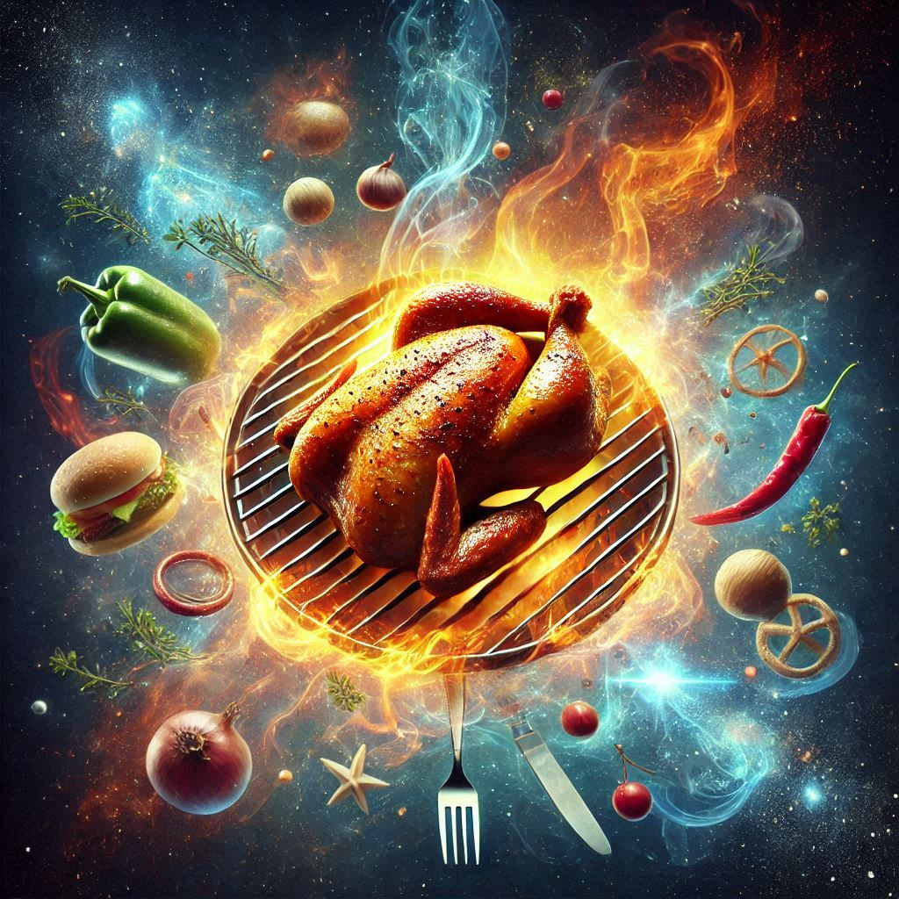
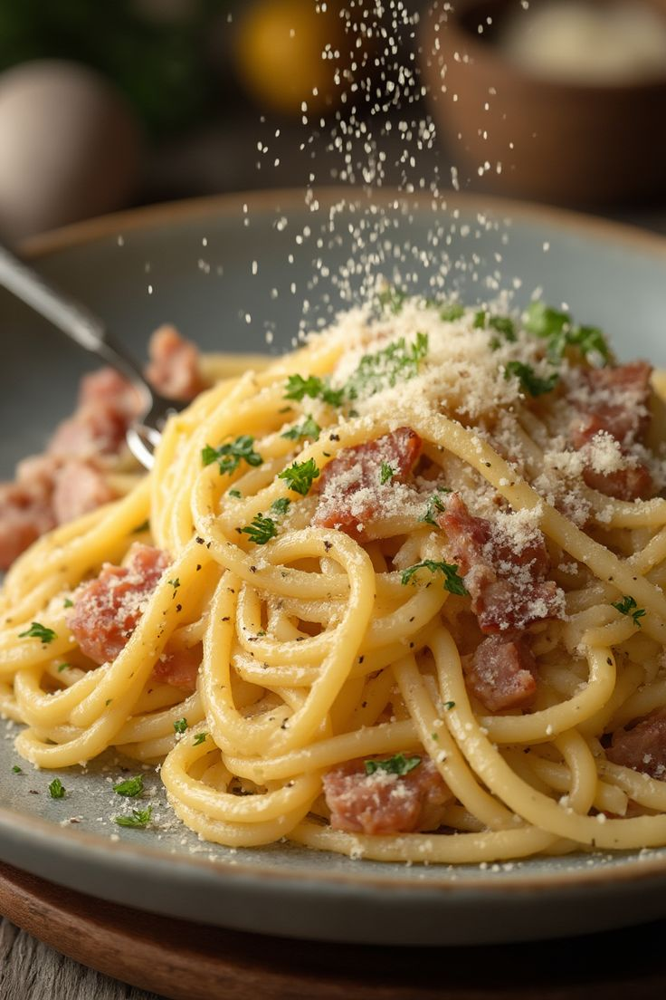
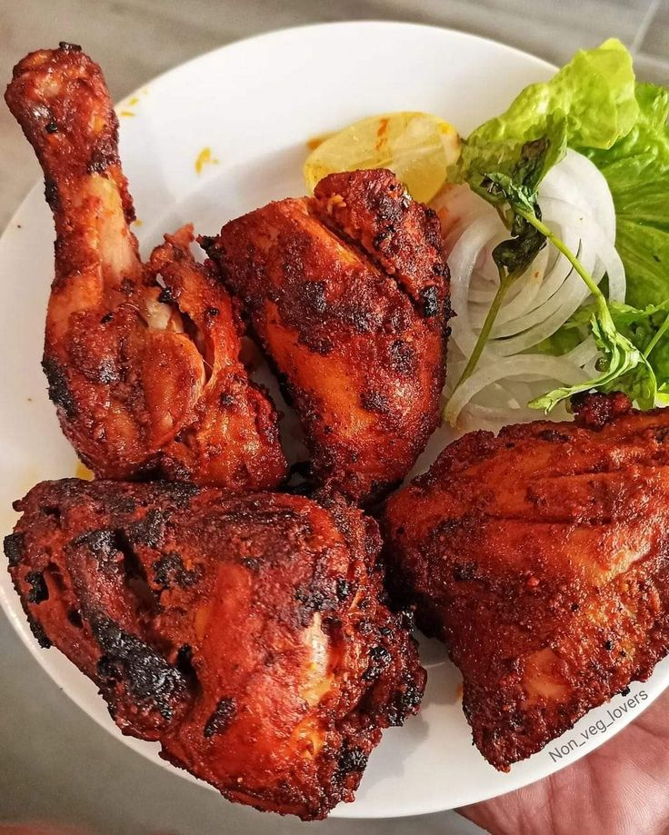

# Foodie

  <strong>Browse the menu. Build your cart. Place an order.</strong> 
  A React food-ordering demo with a separate Express API and a warm, image-led menu.

  
  
  
  

  

  
  &nbsp;
  
  &nbsp;
  

---

## The experience

Explore food by category, add or remove dishes from a cart, create an account, and follow an order through the demo checkout flow.

- Category-based menu browsing with a local catalog fallback.
- Cart updates and order placement.
- Registration and login using password hashing and JWT authentication.
- Order history for the signed-in user.
- Food images served by the Express backend.

## How it works

~~~mermaid
flowchart TD
    customer["Customer"] --> web["React single-page app"]
    web --> catalog["Menu API and local catalog fallback"]
    web --> api["Express REST API"]
    api --> auth["User routes: bcryptjs and JWT"]
    api --> cart["Cart and order routes"]
    cart --> json["JSON-file storage: backend/db.json"]
    api --> images["Static menu images at /images"]
    checkout["Order verification demo"] --> cart
~~~

## Tech stack

| Area | Technologies |
| --- | --- |
| Frontend | React 18, Create React App, React Router 6, Axios |
| Forms and UI | Formik, Yup, Font Awesome, Bootstrap Icons |
| Backend | Node.js, Express 4, Multer |
| Authentication | bcryptjs, JSON Web Tokens |
| Data | JSON file storage in backend/db.json |

## Run locally

Start the backend in one terminal:

~~~bash
cd backend
npm install
npm run dev
~~~

The API listens on http://localhost:4000.

Start the React app in another terminal:

~~~bash
cd Project1-main
npm install
npm start
~~~

Open http://localhost:3000. The frontend currently uses http://localhost:4000 as its API base URL.

## Checkout note

The order verification route is a local demo flow. It does not connect to a real payment provider or charge a payment method. The backend stores data in a JSON file, so this setup is intended for local demonstration rather than concurrent production use.

## Project layout

- Project1-main/ — React frontend, pages, menu data, and food photography.
- backend/ — Express server, route handlers, authentication middleware, and JSON data.
